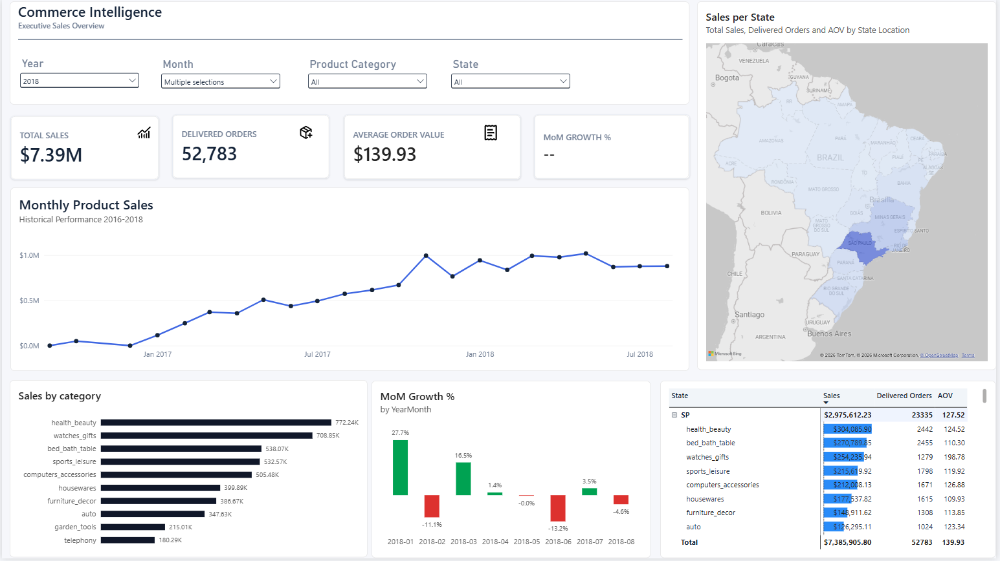
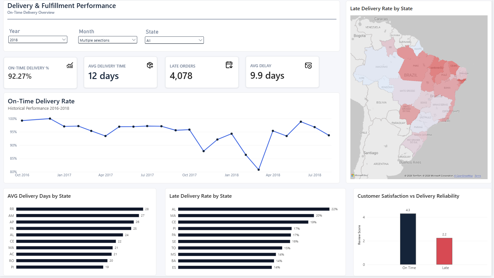
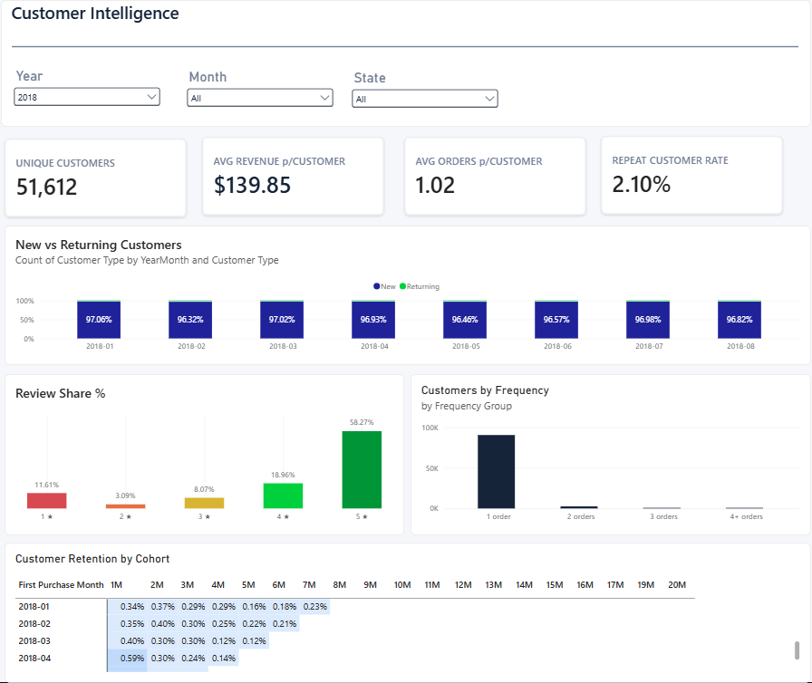

# Olist E-Commerce Analytics | Power BI

A multi-page Power BI portfolio project exploring **sales performance, delivery efficiency, and customer behavior** using the public Brazilian Olist e-commerce dataset.

This report turns relational order, product, payment, review, and customer data into an interactive business intelligence experience. The focus is not only on visual presentation, but also on **KPI definitions, data-model relationships, DAX calculations, and validation of analytical results**.

> **Project status:** Three dashboard pages are documented below. Screenshots are available in this repository; an interactive public report and downloadable Power BI file are not currently provided.

## Dashboard previews

### 1. Sales Overview



**Focus:** Monitor commercial performance and product demand.

- Product sales, delivered orders, average order value (AOV), and month-over-month (MoM) growth
- Monthly sales trends
- Product-category performance
- Geographic sales distribution across Brazilian states

### 2. Delivery & Fulfillment Performance



**Focus:** Evaluate delivery reliability and identify regional fulfillment differences.

- Average delivery time and late-delivery metrics
- On-time delivery performance and trends
- Geographic comparisons of delivery outcomes
- Relationship between delivery timeliness and customer review scores

### 3. Customer Intelligence



**Focus:** Understand purchasing patterns, repeat buying, and customer satisfaction.

- Unique customers and average orders / revenue per customer
- New versus returning customer activity
- Customer purchase-frequency distribution
- Review-score distribution
- Monthly customer-cohort retention analysis

## Business questions

The report is designed to help answer questions such as:

1. How do sales and order volumes change over time?
2. Which categories and regions contribute most to sales?
3. Where is delivery performance strongest or weakest?
4. How do late deliveries relate to customer satisfaction?
5. How frequently do customers return after their first purchase?
6. How does repeat purchasing vary across customer acquisition cohorts?

## Data source

**Dataset:** [Brazilian E-Commerce Public Dataset by Olist](https://www.kaggle.com/datasets/olistbr/brazilian-ecommerce)

The dataset contains historical Brazilian marketplace transactions from approximately 2016–2018. Relevant source tables include orders, order items, customers, products, reviews, payments, and geolocation.

**Important modeling detail:** `customer_id` identifies an order-level customer record, while `customer_unique_id` is used to identify repeat purchasers across orders. Order- and customer-level metrics must therefore be calculated at their appropriate grains.

## Tools and analytical approach

| Tool | Role |
| --- | --- |
| **Power BI Desktop** | Interactive reports, filtering, and presentation |
| **Power Query** | Data loading and shaping |
| **DAX** | Business metrics and filter-context logic |
| **DuckDB / SQL** | Independent data checks and customer cohort aggregations |

Key implementation considerations:

- Modeling relationships across orders, items, customers, products, and reviews
- Avoiding double counting when joining tables of different granularities
- Restricting selected commercial and delivery KPIs to **delivered orders**
- Distinguishing **order counts** from **distinct customer counts**
- Defining cohort retention as repeat purchase activity in a specific month after a customer's first observed purchase
- Recognizing that recent cohorts have shorter observation windows

## Selected KPI definitions

| KPI | Definition |
| --- | --- |
| **Product Sales** | Sum of item prices for delivered orders; excludes freight unless otherwise stated |
| **Delivered Orders** | Distinct orders with `order_status = 'delivered'` |
| **Average Order Value (AOV)** | Product Sales ÷ Delivered Orders |
| **Unique Customers** | Distinct `customer_unique_id` values associated with delivered orders |
| **Orders per Customer** | Delivered Orders ÷ Unique Customers |
| **Repeat Customer Rate** | Share of unique customers with two or more delivered orders within the defined analysis period |
| **On-Time Delivery Rate** | Share of delivered orders arriving on or before their estimated delivery date, subject to valid date availability |
| **Monthly Cohort Retention** | Customers purchasing in a later calendar month ÷ customers in their first-purchase cohort |

**Metric scope matters:** All-time repeat purchase frequency and historical cohort retention are different from measures recalculated within a selected month or year. Visual labels and filter interactions should make their scope clear.

## Data validation and limitations

The analysis uses SQL/DuckDB checks alongside Power BI to validate distinct-order counts, unique-customer counts, and aggregations at the correct data grain.

This is a **historical, public portfolio dataset**, not a live production integration. Findings should not be interpreted as current Olist business performance. In particular, observed repeat purchase rates may be affected by the limited observation period, and late cohorts have less time to generate follow-up purchases.

## Exploring the report

The screenshots above provide a preview of each page. A publicly hosted interactive report and the full `.pbix` file are not yet linked here.

If you would like to inspect the underlying source data, use the Olist dataset linked above. Screenshots may reflect specific report filter selections rather than whole-dataset totals.

## Repository contents

```text
olist-ecommerce-powerbi/
├── README.md
├── sales_overview_page.png
├── delivery_page.png
└── customer_intelligence.png
```

## Next improvements

- Publish an interactive version of the report if sharing permissions allow
- Share the Power BI project file through an appropriate download method
- Add a concise data-model diagram and documented SQL validation queries

---

*Portfolio project created for business intelligence and analytics demonstration. Olist is the source of the public dataset; this repository is not affiliated with Olist.*
